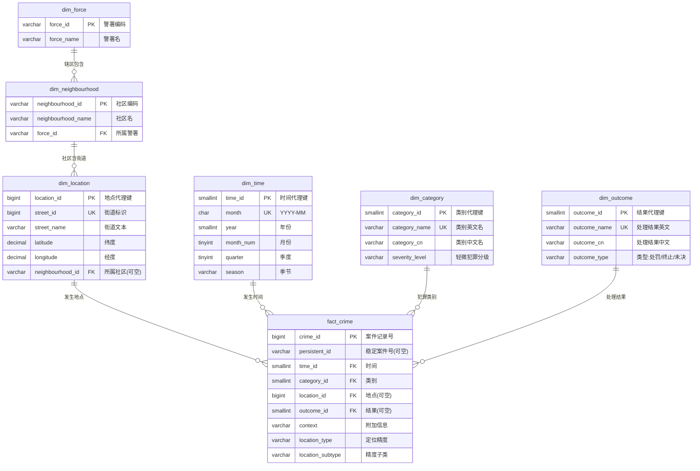

# 城市计算之轻微犯罪数据库 —— 方案A 设计（基于英国 data.police.uk 真实数据）

> 数据源：英国警方开放数据 [data.police.uk](https://data.police.uk/)（Crimes at street-level）
> 下载范围：利兹（Leeds）市区及近郊，2024-01 ~ 2024-06，逐案街道级犯罪记录
> 设计取向：**方案A —— 收敛到"时空核心"**，所有表均可由真实数据填充；人员 / 警员 / 证据等涉及个人隐私的维度，因政府依法脱敏不公开，故不纳入本库（报告中予以说明）。

---

## 一、数据源字段 → 实体映射

street-level API 单条记录（已实测）关键字段与本库实体的对应关系：

| 数据源字段 | 含义 | 映射到实体/属性 |
|---|---|---|
| `id` | 案件记录唯一号（本数据集内唯一） | `fact_crime.crime_id`（主键） |
| `persistent_id` | 稳定案件号（跨月追踪，可为空） | `fact_crime.persistent_id` |
| `month` | 发生月份 `YYYY-MM` | `dim_time.month` |
| `category` | 犯罪类别（anti-social-behaviour 等） | `dim_category` |
| `latitude` / `longitude` | 脱敏到街道级的坐标 | `dim_location` |
| `street_id` / `street_name` | 街道标识 / "On or near …" 文本 | `dim_location` |
| `location_type` / `location_subtype` | 定位精度（Force/Neighbourhood/BTP） | `fact_crime`（精度标记） |
| `outcome_category` / `outcome_date` | 处理结果（警告/罚款/社区判决…） | `dim_outcome` |
| `context` | 附加信息 | `fact_crime.context` |
| —（配套接口） | 警署 / 社区 | `dim_force` / `dim_neighbourhood` |

地理层级（配套接口 `/api/forces`、`/{force}/neighbourhoods` 已抓取）：
**force（警署，44 个）→ neighbourhood（社区，西约克郡 21 个）→ street（街道）**，
即 `fact_crime → dim_location → dim_neighbourhood → dim_force` 三级空间层级，支撑"社区治安热点"分析。

---

## 二、ER 图（收敛后）

核心结构是一个**星型/雪花型模型**：`fact_crime` 是时空事件（点模型——特定月份 + 特定坐标），外键指向四个维度（时间 / 类别 / 地点 / 处理结果），地点维度再上卷到社区与警署。这与你原文档强调的"每条轻微犯罪记录本质是一个时空事件（Spatiotemporal Event）"完全一致。

---

## 三、逻辑设计（关系模式 + 3NF）

### 1. dim_force（警署 / 部门）
- 属性：`force_id`(PK), `force_name`
- 主键：`force_id`；无部分/传递依赖，满足 3NF。
- 数据：44 行（全英 43 警署 + 英国交通警察 BTP）。

### 2. dim_neighbourhood（社区 / 行政区划）
- 属性：`neighbourhood_id`(PK), `neighbourhood_name`, `force_id`(FK→dim_force)
- `force_id` 仅由 `neighbourhood_id` 决定，无 `neighbourhood_id → force_id → …` 传递依赖，满足 3NF。
- 数据：西约克郡 21 个社区（含 Leeds City / East / North East / North West / South / West）。

### 3. dim_location（地点 / 空间维度）
- 属性：`location_id`(PK), `street_id`(UNIQUE), `street_name`, `latitude`, `longitude`, `neighbourhood_id`(FK, 可空)
- 坐标与地址文本均直接依赖 `location_id`；`neighbourhood_id` 通过坐标"点在多边形内"判定回填（离线完成，导入时赋值），满足 3NF。
- 空间坐标按你原文档 4.3 节策略：以普通 `DECIMAL(10,7)` 浮点存储，不启用 PostGIS；半径/缓冲区查询用平方距离公式在应用层或 SQL 表达式完成。

### 4. dim_time（时间维度）
- 属性：`time_id`(PK), `month`(UNIQUE), `year`, `month_num`, `quarter`, `season`
- 派生属性（year/quarter/season）全部直接依赖代理键 `time_id`，`month → year` 等函数依赖不构成传递依赖，满足 3NF。
- 数据：6 行（2024-01 ~ 2024-06）。

### 5. dim_category（犯罪类别，含轻微犯罪分级）
- 属性：`category_id`(PK), `category_name`(UNIQUE), `category_cn`, `severity_level`
- 在"案件类型"之上增加了你原文档建议的**轻微犯罪分级**（CrimeSeverity 思想），按 UK 类别映射为 `轻微 / 一般 / 较重 / 严重`。
- 数据：英国标准 14 类（见下）。

### 6. dim_outcome（处理结果 / 处罚方式）
- 属性：`outcome_id`(PK), `outcome_name`(UNIQUE), `outcome_cn`, `outcome_type`
- 对应你原文档"细化处罚方式"实体：`警告 / 罚款通知 / 社区判决 / 现场调解` 是 outcome 的**处罚型**子集，另有**终止型**（无法起诉/无嫌疑人）与**未决型**（调查中），三者统一管理又彼此区分。
- 数据：英国标准 outcome 类别（约 10 类）。

### 7. fact_crime（案件记录 / 事实）
- 属性：`crime_id`(PK), `persistent_id`, `time_id`(FK), `category_id`(FK), `location_id`(FK, 可空), `outcome_id`(FK, 可空), `context`, `location_type`, `location_subtype`
- 所有非主属性直接依赖 `crime_id`，满足 3NF。
- 规模：约数万行（下载完成后以 `meta.json` 为准）。

**关键说明（相对原 ER 的收敛）**：
- 原 `Case` → 现 `fact_crime`（去掉了多对多关联，因为开放数据不提供涉案人员/警员）。
- 原 `Case ↔ Location` 多对多 → 现 `fact_crime.location_id` 多对一（开放数据一案件只挂一个街道级地点）。
- 原 `Punishment` → 现 `dim_outcome`（`outcome_category` 即"处罚/处理结果"）。
- 原 `Department` → 现 `dim_force`；原 `District` → 现 `dim_neighbourhood`。
- 删除 `Person / Officer / Evidence / Complaint` 及相应关联表（政府隐私脱敏，无真实数据）。

---

## 四、轻微犯罪分级映射（项目自定义，报告中说明依据）

| category（UK 类别） | 中文 | severity_level |
|---|---|---|
| anti-social-behaviour | 扰乱公共秩序 | 轻微 |
| bicycle-theft | 自行车盗窃 | 轻微 |
| shoplifting | 商店行窃 | 轻微 |
| other-theft | 其他盗窃 | 轻微 |
| vehicle-crime | 涉车犯罪 | 一般 |
| public-order | 公共秩序 | 轻微 |
| criminal-damage-arson | 毁坏财物/纵火 | 一般 |
| theft-from-the-person | 扒窃 | 一般 |
| drugs | 毒品 | 较重 |
| other-crime | 其他犯罪 | 一般 |
| burglary | 入室盗窃 | 较重 |
| possession-of-weapons | 持有武器 | 较重 |
| robbery | 抢劫 | 严重 |
| violent-crime | 暴力犯罪 | 严重 |

> 分级用于演示"轻微犯罪"的筛选与统计（如 `WHERE severity_level='轻微'`），并在报告中与《治安管理处罚法》的治安案件/刑事案件区分做类比说明。

## 五、处理结果（outcome）分类

- **处罚型**：`Offender given a caution`（警告）、`Offender given penalty notice`（罚款通知）、`Offender given community sentence`（社区判决/社区服务）、`Local resolution`（现场调解/当地解决）。
- **终止型**：`Unable to prosecute suspect`、`Investigation complete; no suspect identified`、`Formal action is not in the public interest`。
- **未决型**：`Under investigation`、`Awaiting court outcome`、`Court result unavailable`。

## 六、待数据落盘后补全

- `data/meta.json` 给出总条数、逐月条数；
- 按 `category` / `outcome_category` 的真实频次，最终定稿 `dim_category` 与 `dim_outcome` 字典（含中文名与分级）；
- 生成建库 SQL（DDL + 索引 + 视图）与导入脚本。
